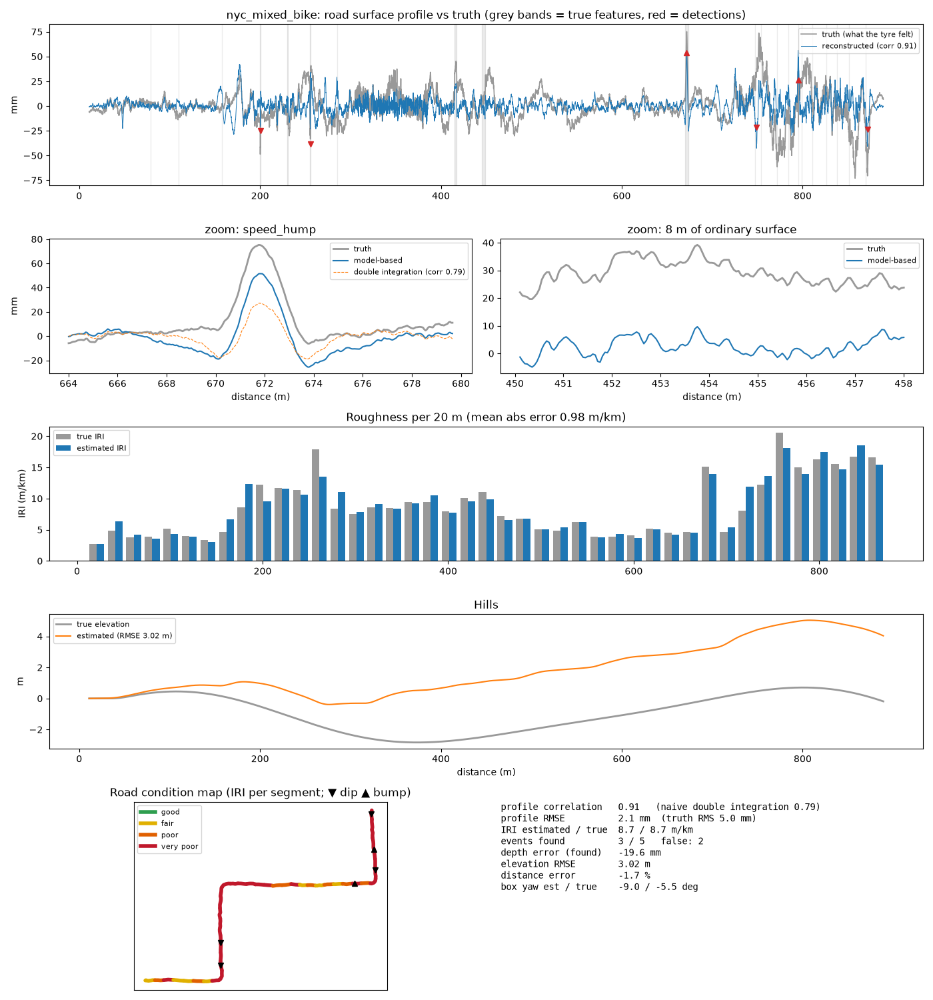
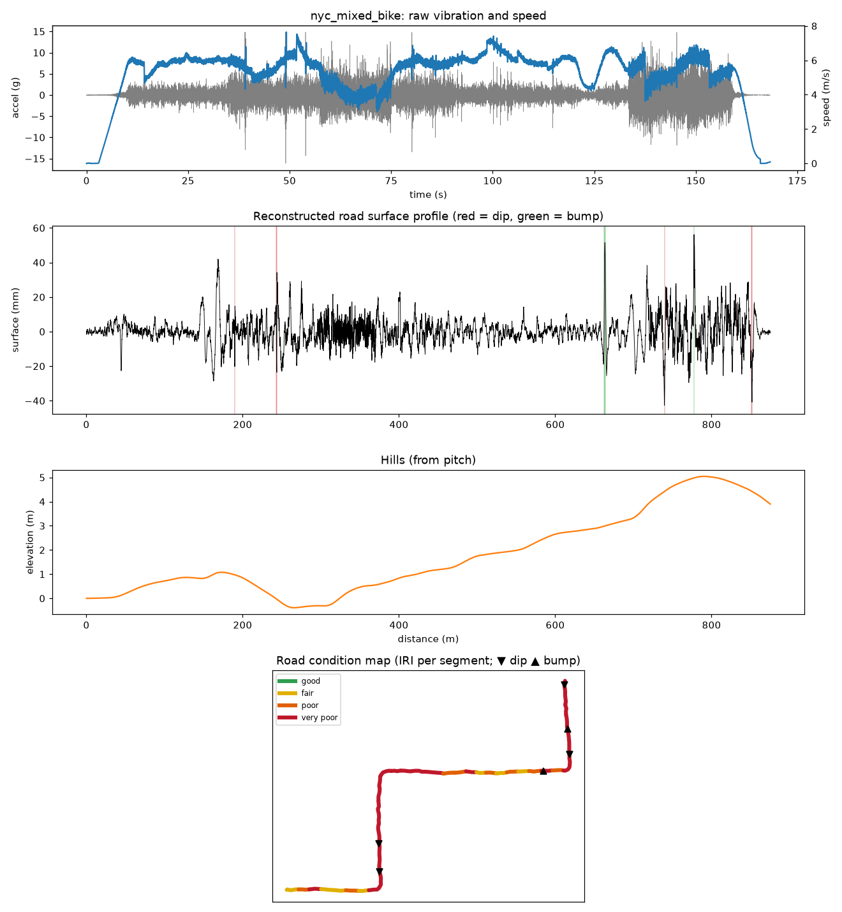

# roadimu: IMU road simulator and topography pipeline

This package has two halves:

1. **A simulator.** It generates the IMU data our box *would* record on a bike or car over different real-world road conditions. The output is a CSV in exactly the [`docs/data-schema.md`](../../docs/data-schema.md) format, plus ground truth.
2. **A signal-processing pipeline.** It turns an IMU log (simulated now, real later) into road **topography**:
   - the road surface profile (mm)
   - hills (m)
   - roughness (IRI) per 20 m
   - a list of potholes and bumps, judged from the IMU alone and placed on the map with GPS

Because the simulator knows the true road, every part of the pipeline is scored against ground truth.



## Quick start

```bash
cd software/roadimu
python3 -m venv ../../.venv && ../../.venv/bin/pip install -r requirements.txt
source ../../.venv/bin/activate

python -m roadimu list                                                    # road scenarios
python -m roadimu simulate --scenario nyc_mixed --vehicle bike            # -> out/sim/nyc_mixed_bike_imu.csv
python -m roadimu reconstruct out/sim/nyc_mixed_bike_imu.csv --vehicle bike   # -> out/topo/...
python -m roadimu evaluate                                                # all scenarios x bike/car, scored, with plots
pytest                                                                    # 12 tests, ~2 s
```

`reconstruct` works on **any** CSV in the schema format. Once the hardware streams real data, run it on a recorded ride the same way.

## What the simulator models

| Layer | What's simulated | Where |
|---|---|---|
| Road surface | ISO 8608 random roughness (classes A–H); potholes, cracks, manholes, utility patches, steel plates, speed bumps/humps, raised crosswalks; cobblestones, gravel, concrete slabs with faulting | `road.py`, `scenarios.py` |
| Hills and route | Gentle grades (up to ~3%), 90° street turns, GPS lat/lon (anchored in Manhattan) | `road.py` |
| Tyre | Can't drop into cracks narrower than its contact patch; rolls over pothole edges (rigid-disc envelope) | `road.tyre_envelope` |
| Vehicle | **Bike:** frame + rider on tyres, with a saddle, hands and pedals (rider bounce 4.5 Hz, frame 28/40 Hz). **Car:** body + 2 axles (body bounce 1.2 Hz, wheel hop 12 Hz). Tyres can **leave the ground**. Front and rear wheels hit each bump one wheelbase apart. Every simulated rider and car is randomly ±12% different from the model the pipeline uses | `vehicle.py` |
| Rider / engine | Pedalling forces (~84 rpm), rider shifting, rocking, leaning into turns; engine vibration and body roll for the car | `simulate.py` |
| IMU (ICM-42688-P) | 70 µg/√Hz and 2.8 mdps/√Hz noise, ±20 mg / ±0.5 dps bias, scale and cross-axis error, on-chip low-pass filter (ODR/4), 200 Hz output, ±16 g / ±2000 dps saturation, 16-bit quantisation | `sensors.py` |
| Mounting | Box tilted ±4° and rotated up to ±15° on the handlebar/dashboard | `simulate.py` |
| Link and phone | ESP32 clock drift (±30 ppm), whole-millisecond timestamps, **0.5% lost BLE packets**, 1 Hz phone GPS with ±3 m wandering error | `sensors.py` |
| Rider button | Presses after noticeable bumps with 0.25–1.5 s reaction delay; misses about 15%; occasional accidental presses | `sensors.simulate_button` |

Scenarios: `smooth_asphalt`, `worn_asphalt`, `potholes`, `cobblestone`, `gravel`, `speed_bumps`, `concrete_slabs`, `nyc_mixed` (~0.9 km demo route).

## How the pipeline turns vibration into topography

```
IMU CSV ──► 1. clean-up ──► 2. calibrate mount ──► 3. attitude + speed ──► 4. road profile ──► 5. roughness
            uniform 200 Hz   gravity at standstill   GPS-aided complementary  model-based Wiener     IRI per 20 m
            GPS fixes        -> tilt; GPS dv/dt       filter -> pitch/roll,    deconvolution          with lat/lon
            lost packets     -> which way is forward  speed, distance, hills   (accel + gyro)
        │
        └──► 6. potholes + bumps from the IMU only (own "up", pitch axis and speed) ──► GPS adds the map position
```

1. **Clean-up** (`topo/preprocess.py`): put samples on a uniform time grid and flag the gaps from lost packets.
2. **Mount calibration:**
   - **Tilt:** while stopped, the accelerometer only sees gravity, which gives the box's tilt. The detector requires every axis and GPS to be quiet, because a smooth pull-away barely changes |a|.
   - **Forward direction:** the horizontal direction whose acceleration co-varies with GPS speed changes. This works even if the box is mounted sideways.
3. **Attitude, speed, hills** (`topo/attitude.py`):
   - **Attitude:** a Mahony filter, after removing the acceleration GPS already explains (speeding up, braking, centripetal force in turns), so braking doesn't look like a downhill and leaning doesn't look like a tilted road.
   - **Vibration-rectification correction:** frame pitch × vertical vibration biases the forward axis by about 0.3° on a rigid bike. That's 3 m of fake hill per km, so the pipeline subtracts it.
   - **Speed:** GPS speed fused with the IMU.
   - **Hills:** the integral of sin(pitch) over distance.
4. **Road profile** (`topo/profile.py`): the IMU measures the vehicle's *response* to the road, not the road itself.
   - **Inversion:** a multi-channel Wiener filter in 4 s windows using the vehicle model, which includes the rear wheel hitting each bump later and the IMU's own filter. The gyro's pitch rate separates front-wheel hits from rear-wheel hits.
   - **Lost packets:** filled with zero, not interpolated. A straight line across a 2 g vibration creates a fake 20 cm pothole.
5. **Roughness** (`topo/roughness.py`):
   - **IRI:** the standard "golden car" International Roughness Index, which DOTs use.
   - **RMS roughness:** for wavelengths under 5 m, closer to what a cyclist feels.
6. **Potholes and bumps, from the IMU alone** (`topo/impacts.py`). GPS is only used for the map: a bad fix, an
   urban canyon or no GPS at all can move a pin but can't add, remove or resize an event (`test_bump_detection_ignores_gps`).
   - **Up:** the slow (< 0.3 Hz) part of the accelerometer is gravity; vertical acceleration is measured along it. No mounting calibration needed.
   - **Pitch axis:** the horizontal axis the gyro vibrates around most (> 3 Hz). Its sign is the one for which the vehicle model explains accelerometer and gyro together best.
   - **Speed, from the front-rear echo:** the rear tyre hits every bump `wheelbase / speed` after the front one. In each 4 s window the pipeline tries speeds from 1 to 14 m/s (car: 25) and keeps the one that fits both channels best. Median error on the simulated rides: 0.05–0.3 m/s. Where nothing fits, the vehicle is standing still.
   - **Road under the tyre:** the same Wiener deconvolution as step 4, driven by these IMU-only signals.
   - **Event detection:** dips and rises against a running median at two scales (3 m and 15 m). The threshold is the larger of 20 mm and k × the local roughness (k = 5 for a bike, 4 for a car), so cobblestones don't count as potholes.
   - **Map position:** each event's time is looked up in the GPS track and the ride distance.

The baseline (double integration with high-pass filters) is computed alongside for comparison.

## Results (seed 0, `python -m roadimu evaluate`)

"Profile corr" compares the reconstructed and true surface at wavelengths of 0.3–8 m. Events are potholes, bumps, humps, plates and patches deeper or higher than 26 mm.

| Run | Profile corr | Baseline corr | RMSE / truth RMS (mm) | IRI est / true (m/km) | Events found | False | Hills RMSE (m) | Dist err |
|---|---|---|---|---|---|---|---|---|
| smooth_asphalt_bike | 0.89 | 0.77 | 0.5 / 1.0 | 2.2 / 2.1 | 0/0 | 0 | 0.48 | +0.3% |
| smooth_asphalt_car | 0.98 | -0.13 | 0.2 / 1.0 | 2.1 / 2.1 | 0/0 | 0 | 0.04 | -0.3% |
| worn_asphalt_bike | 0.97 | 0.87 | 1.0 / 4.0 | 8.0 / 8.2 | 0/1 | 0 | 0.44 | +0.4% |
| worn_asphalt_car | 0.99 | -0.11 | 0.7 / 4.0 | 8.1 / 8.2 | 1/1 | 0 | 0.41 | -0.1% |
| potholes_bike | 0.93 | 0.84 | 2.1 / 5.5 | 9.0 / 10.5 | 5/6 | 0 | 0.59 | +1.1% |
| potholes_car | 0.95 | -0.06 | 1.8 / 5.4 | 11.5 / 10.5 | 6/6 | 0 | 0.31 | -0.3% |
| cobblestone_bike | 0.86 | 0.72 | 2.1 / 3.7 | 6.9 / 6.5 | 0/0 | 0 | 0.67 | +3.0% |
| cobblestone_car | 0.98 | 0.01 | 0.8 / 3.6 | 6.1 / 6.5 | 0/0 | 0 | 0.03 | -0.4% |
| gravel_bike | 0.98 | 0.91 | 1.3 / 6.9 | 11.5 / 12.2 | 0/0 | 0 | 1.02 | +3.9% |
| gravel_car | 0.96 | 0.27 | 2.0 / 6.8 | 13.4 / 12.3 | 0/0 | 2 | 0.09 | -0.6% |
| speed_bumps_bike | 0.91 | 0.67 | 1.8 / 4.2 | 5.5 / 5.5 | 2/3 | 0 | 0.90 | -0.3% |
| speed_bumps_car | 0.85 | 0.17 | 2.2 / 4.2 | 4.1 / 5.5 | 2/3 | 0 | 0.11 | -0.4% |
| concrete_slabs_bike | 0.98 | 0.95 | 0.5 / 2.5 | 5.2 / 5.5 | 0/0 | 0 | 0.58 | +1.2% |
| concrete_slabs_car | 0.99 | -0.13 | 0.4 / 2.5 | 5.4 / 5.5 | 0/0 | 0 | 0.08 | -0.5% |
| nyc_mixed_bike | 0.91 | 0.79 | 2.1 / 5.0 | 8.7 / 8.7 | 3/5 | 1 | 3.02 | -1.7% |
| nyc_mixed_car | 0.97 | 0.05 | 1.2 / 4.9 | 8.1 / 8.7 | 3/5 | 2 | 0.97 | -0.5% |

Across 8 random seeds of the `potholes` road on a bike (3.1 km), the IMU-only detector found 28 of 44 expected events with 4 false alarms: about one false alarm per 800 m on a heavily potholed street. The GPS-distance detector it replaced found 29 with 7 false alarms. On cars it finds the same events as before but raises a few more false alarms (seed 0: 4 vs 1), mostly on gravel.

### What this means (and its limits)

- **The road surface profile and IRI are the strong result.** Correlation is 0.85–0.99 on every road and both vehicles. IRI is typically within 1–1.5 m/km. Naive double integration fails badly on cars (correlation near 0), because it ignores the suspension.
- **Detected depths are underestimated.** Reported pothole depths are roughly 60–80% of the true depth. On short, deep potholes the bike's wheel partly flies over the hole, so the IMU can only report what the wheel actually did. Use depth as a severity ranking, not a measurement.
- **Hills are only approximate on a bike.** Errors are about 0.5–1 m per km on straight routes, but up to about 3 m when there are turns, where leaning confuses the tilt estimate. The car is better (under 1 m). **Recommendation:** have the app also log the phone's barometric altitude (most phones have a barometer, about 0.1–0.3 m relative accuracy) and use the IMU only for the fine detail.
- **This all assumes the nominal vehicle model.** The simulator varies it by ±12%, and results hold. A real bike should get a quick calibration ride over a known bump to tune `BikeParams`.
- **Not modelled:** frame flex, tyre pressure changes during a ride, handlebar-mount rubber, a rider standing up on the pedals, and wet roads.

## Recommendations for the hardware team

These come from the simulation:
- **Accelerometer range:** use ±16 g. Pothole edges on a rigid bike reach 16 g at the handlebar.
- **Sample rate:** **200 Hz with the UI filter at ODR/4** is enough. 500 Hz didn't improve results and doubles BLE traffic.
- **Mounting:** mount the box **rigidly**; the pipeline assumes a rigid mount (rubber isolation isn't modelled). Any orientation works, because calibration figures it out.
- **Calibration stop:** start every session with **≥ 2 s standing still on level ground**. That's when calibration happens.
- **Packet loss:** some lost BLE packets are fine (they're handled), but send `t_ms` with every sample so gaps are detectable.

## Using it with the Road Reader app

The iPhone app ([`groundtruth_app`](../../groundtruth_app/README.md)) streams to `listener.py`, which runs this
pipeline live with `--analyze`. `upload_server.py` runs it on every uploaded session. The app shows the results
live and on a map. Parts of the package involved:
- **`appio.py`:** reads the app's CSV (`phone_time_ms`, optional `device_time_ms`, GPS columns that are blank until
  a fix). Without ESP32 timestamps, it rebuilds a uniform time base from the bursty Bluetooth arrival times and
  detects lost samples.
- **`live.py`:** the background re-analysis used by the listener.
- **`reconstruct()`:** accepts either CSV format. With no GPS it falls back to an assumed speed (with a note) instead
  of failing.
- **`simulate --format app` and `replay`:** produce and stream app-format rides for demos without hardware.

How well it works on the app's data stream (simulated, potholes + NYC routes, 2 seeds each; measured with the earlier GPS-distance event detector):

| Firmware | Bike profile corr | Bike events found / false | Car profile corr |
|---|---|---|---|
| Original `esp32.ino`: 50 Hz polled, no timestamp | 0.13 | 8/22, 60 false | 0.92 |
| … + ESP32 timestamp | 0.16 | 8/22, 61 false | 0.96 |
| **Updated `esp32.ino`: 200 Hz polled + timestamp** | **0.86** | **13/22, 5 false** | **0.97** |
| 200 Hz with the IMU's own ODR/4 filter + timestamp | 0.84 | 13/22, 2 false | 0.96 |

## Outputs of `reconstruct`

| File | Contents |
|---|---|
| `<name>_topography.csv` | `s_m, lat, lon, elevation_m, profile_mm, topography_m` every 5 cm |
| `<name>_segments.csv` | Per 20 m: `iri_m_per_km, rms_mm, condition` (good / fair / poor / very poor), with lat/lon (for the dashboard map) |
| `<name>_events.csv` | `t_s, lat, lon, type, severity, source, magnitude_mm, s_m, length_m`, matching the `events` table in the data schema |
| `<name>_summary.json` | Calibration results and totals |
| `<name>_report.png` | One-page figure (see below) |



## Code map

```
roadimu/
  road.py        road surfaces + tyre envelope          sensors.py   IMU / GPS / button models
  vehicle.py     bike & car dynamics, FRF, time sim     simulate.py  scenario -> CSV + truth
  scenarios.py   the 8 road conditions                  evaluate.py  scoring vs truth
  topo/          preprocess, attitude, profile, roughness, impacts (IMU-only events), pipeline
  plots.py       report + evaluation figures            __main__.py  CLI
tests/           physics sanity checks + end-to-end reconstruction test
```
